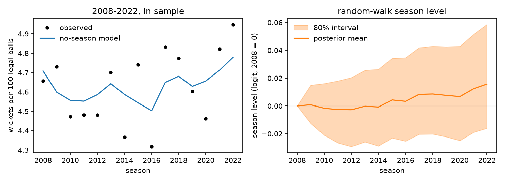
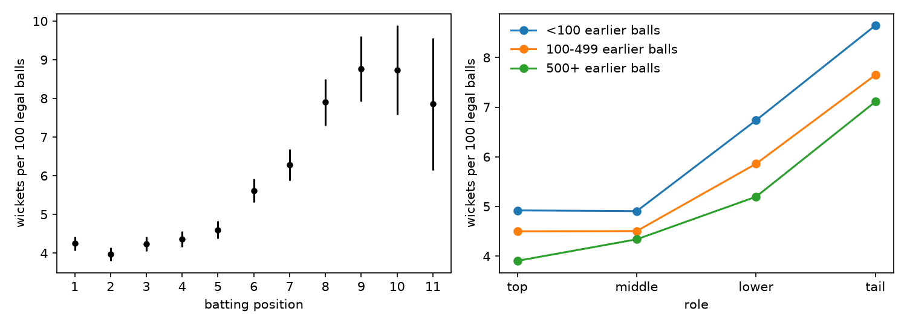
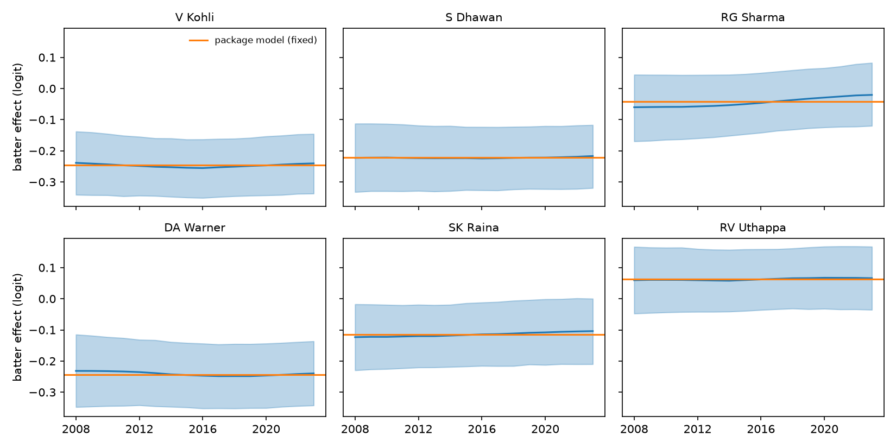

# Cricket_BA: does a hierarchical Bayesian model help with IPL wickets?

How often does a batter get out, and how often does a bowler take a wicket? Most IPL
players have faced or bowled only a few dozen balls, so their raw rates are mostly noise.
This project fits a hierarchical (partially pooled) Bayesian model in PyMC to 18 seasons
of IPL ball-by-ball data and compares it, on later seasons it has not seen, with a tuned
L2-regularised logistic regression.

**Short answer.** On point prediction the two models are close to a tie: the
hierarchical model's test log loss is lower by 0.00019, a 0.10% improvement whose 95%
interval excludes zero but not by much. What the Bayesian model adds is honest uncertainty:
every player gets an interval that is wide when the data is thin and narrow when it is
not, and those intervals cover roughly the share of outcomes they claim to. The largest
gain in prediction is for batters the model has never seen.

## Question and set-up

* **Target.** On a legal ball, does the bowler take the striker's wicket (bowled, caught,
  caught and bowled, lbw, stumped, hit wicket)? Run outs, retirements and super overs
  are left out. 267,801 legal balls, 12,586 such wickets (4.7%).
* **Split by time, never at random.** Train on 2008 to 2023 (234,995 balls), test on
  2024 and 2025 (32,806 balls). In the test seasons 12.7% of balls involve a batter, and
  11.2% a bowler, who never appears in training.
* **Covariates known before the ball.** Phase (powerplay, middle, death); batting role
  from batting position (top 1-3, middle 4-5, lower 6-7, tail 8-11), where position is
  the order in which batters came in; and IPL experience, the legal balls the batter
  faced in earlier matches (under 100, 100 to 499, 500 or more).
* **Baselines.** The overall training rate, the rate per phase, and an L2 logistic
  regression on one-hot batter, bowler, phase, role and experience. Its penalty and
  feature set were chosen by expanding-window cross-validation over 2019 to 2023:
  C = 0.03; role and experience lowered validation log loss, venue did not.
* **Hierarchical model.**
  `logit p = alpha[phase] + sigma_bat * z_bat[batter] + sigma_bowl * z_bowl[bowler]
  + beta * (season - 2016) / 10 + role[role] + experience[experience]`,
  with `z ~ N(0, 1)` (non-centred) and half-normal priors on the two pooling scales,
  which are learnt from the data. A player first seen in the test seasons gets a fresh
  effect drawn from `N(0, sigma)`. The season, role and experience terms were added
  after the first version (see *Season drift* and *Batting role and experience* below).
* **Making NUTS fast without approximating.** The linear predictor depends only on
  (batter, bowler, phase, season, role, experience), so a Bernoulli likelihood on the
  234,995 balls equals a binomial likelihood on the 56,153 cells up to a constant. Same
  posterior, about eleven minutes to sample. `tests/test_hierarchical.py` checks the equality numerically.

## Results

All numbers below are from `make results` (see *How to reproduce*), on the 2024-25 test
seasons.

| Model | Log loss | Brier score | Mean predicted | Observed rate |
|---|---|---|---|---|
| Overall training rate | 0.19973 | 0.04784 | 0.0465 | 0.0504 |
| Rate per phase | 0.19805 | 0.04766 | 0.0463 | 0.0504 |
| Logistic L2 (batter, bowler, phase, role, experience) | 0.19701 | 0.04756 | 0.0473 | 0.0504 |
| Hierarchical (PyMC) | **0.19681** | **0.04754** | 0.0498 | 0.0504 |

Hierarchical minus logistic, with 95% intervals from 1,000 bootstrap resamples of whole
matches: log loss **-0.00019** (-0.00037 to -0.00002), Brier score -0.000016 (-0.000037
to +0.000002). The log-loss gain is real but tiny; the Brier difference cannot be told
apart from zero. Adding role and experience improved both models (logistic 0.19726 to
0.19701, hierarchical 0.19708 to 0.19681). The first version, with no season, role or
experience terms, gave hierarchical 0.19713 against logistic 0.19726.

The phase-rate row comes from `results/baseline_test_metrics.csv`, written by
`notebooks/02_baseline.ipynb`; the other rows from `results/test_metrics.csv`.

**Sampler.** 4 chains of 1,000 draws after 1,000 tuning steps, `target_accept` 0.95: no
divergences, R-hat at most 1.01, bulk effective sample size at least 896 for every
parameter.

### Where the hierarchical model helps

Test log loss split by how many training balls the player had (difference is
hierarchical minus logistic; negative favours the hierarchical model):

| Player | Training balls | Test balls | Difference | 95% interval |
|---|---|---|---|---|
| batter | unseen | 4,160 | -0.00075 | -0.00143 to -0.00023 |
| batter | 1-99 | 2,741 | +0.00028 | -0.00075 to +0.00126 |
| batter | 100-499 | 8,639 | -0.00012 | -0.00041 to +0.00018 |
| batter | 500+ | 17,266 | -0.00019 | -0.00041 to +0.00003 |
| bowler | unseen | 3,685 | +0.00006 | -0.00051 to +0.00059 |
| bowler | 1-99 | 1,646 | +0.00008 | -0.00073 to +0.00089 |
| bowler | 100-499 | 8,033 | -0.00018 | -0.00060 to +0.00018 |
| bowler | 500+ | 19,442 | -0.00027 | -0.00048 to -0.00006 |

The clearest gain is for batters new in the test seasons. The logistic model treats a
new batter as exactly average; the hierarchical model knows how far from average a new
batter tends to be, and averages over that. For thin but seen players the intervals are
wide and include zero. I expected the gain to be largest for thin players, and the data
does not show that clearly.

### Estimates for thin and well-known players


Each point is a batter's wicket probability against an average bowler in the middle
overs (the figure is from `03_hierarchical_pymc`, the first version of the model). The
numbers below are from `make results`: for both models they are for a top-order batter
with 500 or more earlier balls, the reference levels, and the hierarchical ones use the
2023 season level. Raw rates for batters with under 100 training balls have a standard
deviation of 0.150 (some are 0, some are 1). Both models pull them hard towards the
average; the L2 logistic regression pulls even harder (standard deviation 0.0013 against
0.0017), with
one penalty for every player and no measure of how unsure it is. The hierarchical model
says how unsure it is:

| Batter | Training balls | Wickets | Raw rate | Logistic | Hierarchical mean | 80% interval |
|---|---|---|---|---|---|---|
| V Kohli | 5,568 | 186 | 0.0334 | 0.0344 | 0.0348 | 0.0317 to 0.0379 |
| S Dhawan | 5,181 | 170 | 0.0328 | 0.0345 | 0.0356 | 0.0324 to 0.0390 |
| RG Sharma | 4,759 | 198 | 0.0416 | 0.0387 | 0.0423 | 0.0386 to 0.0462 |
| LPC Silva | 26 | 2 | 0.0769 | 0.0420 | 0.0454 | 0.0361 to 0.0556 |
| T Thushara | 18 | 1 | 0.0556 | 0.0410 | 0.0439 | 0.0350 to 0.0539 |
| Basil Thampi | 35 | 1 | 0.0286 | 0.0398 | 0.0422 | 0.0337 to 0.0513 |

The three thin batters were drawn at random (fixed seed) from those with 15 to 40
training balls. The median width of an 80% interval is 0.0189 for batters with under 100
training balls and 0.0118 for those with 500 or more.

### Are the intervals calibrated?

For each player with at least 60 legal balls in 2024-25, the model gives a predictive
distribution for their total wickets over those balls (with their actual opponents and
phases). How often does the real total land inside the central interval?

| Players | Model | n | 50% | 80% | 95% |
|---|---|---|---|---|---|
| batters | hierarchical | 109 | 0.59 (PIT 0.48) | 0.86 (PIT 0.84) | 0.97 (PIT 0.95) |
| batters | logistic plug-in | 109 | 0.55 (PIT 0.45) | 0.83 (PIT 0.77) | 0.95 (PIT 0.93) |
| bowlers | hierarchical | 112 | 0.54 (PIT 0.44) | 0.87 (PIT 0.81) | 0.98 (PIT 0.97) |
| bowlers | logistic plug-in | 112 | 0.52 (PIT 0.45) | 0.78 (PIT 0.72) | 0.96 (PIT 0.95) |

"Logistic plug-in" is binomial noise around the logistic point predictions, with no
parameter uncertainty. Wicket totals are whole numbers, so an interval with inclusive
ends covers a little more than its nominal level; the PIT figure is a randomised version
that corrects for this. With about 110 players per row, each figure has a standard error
of about 4 percentage points, and the simulation adds about 1 to 2 points of Monte Carlo
noise (the notebook and the pipeline differ by that much). So the 80% and 95% intervals
are about right for both models; the hierarchical ones are, if anything, slightly wide,
and this test is too small to say that one is better calibrated than the other. The 50%
PIT figures are below 0.5 in every row, which points to the remaining under-prediction
of new batters (see *Batting role and experience*).


### Season drift

The first version of both models predicted 4.85% for the test seasons against an observed
5.04%. The raw rate rose from 4.3% (2016) to 5.0% (2023 to 2025), and neither model had a
season term. `notebooks/04_season_drift.ipynb` tests one, choosing on 2023 as a
validation season and scoring the test seasons only at the end.



* **Most of the rise is a change of players.** With only batter, bowler and phase, the
  model's in-sample rate already rises from 4.50% (2016) to 4.78% (2022). A random-walk
  season level on top moves by 0.016 on the logit scale by 2022 (80% interval -0.016 to
  0.058), about 1.5% of the rate.
* **The choice.** A numeric season feature made the logistic baseline slightly worse in
  cross-validation (mean log loss 0.188568 against 0.188557), so it stays out. For the
  hierarchical model a linear trend and a random-walk level tied on 2023 (0.195723 and
  0.195722 against 0.195743 with no term). I kept the linear trend: one parameter, no
  divergences, and a 2023 mean prediction of 4.97% against 4.98% observed.
* **On the test seasons** the trend moves the mean prediction to 4.98% and is 0.042 per
  decade on the logit scale (94% HDI -0.009 to 0.094). Against the same model without
  it, the log-loss change is -0.000055 (95% interval -0.000114 to +0.000007), so the
  trend fixes the average but is not a clear gain ball by ball.
* **The remaining gap was new batters.** Split by whether the batter and bowler were seen
  in training, balls with two seen players were well predicted (4.96% against 4.91%
  observed), but batters new in 2024-25 were out on 6.30% of balls against seen bowlers,
  where the model predicted 5.26% and the logistic baseline 5.00%.

### Batting role and experience

`notebooks/05_batting_role.ipynb` asks why new batters were under-predicted. New batters
are a little more often tail-enders (10.5% of their balls, against 6.4% for seen
batters), but they were out more often in every role: top-order newcomers on 5.9% of
balls against 4.4% for seen top-order batters. So the notebook tests IPL experience as
well as role.



* **Both matter.** In the package model, fewer than 100 earlier IPL balls adds 0.20 on
  the logit scale (94% HDI 0.13 to 0.25) against 500 or more, and 100 to 499 adds 0.09.
  Given each batter's own effect, role adds less than the raw rates suggest (middle order
  -0.11, lower -0.09, tail +0.02 against the top order), because a tail-ender's own
  effect already carries most of it. The batter pooling scale falls from 0.22 to 0.17:
  part of what the first model called individual skill was experience.
* **A change of protocol, disclosed.** I first chose on 2023 alone, as in `04`. There the
  package model was slightly ahead (difference +0.000056, interval -0.00019 to +0.00030),
  but the test seasons then favoured role and experience clearly. The two disagreed
  because the hierarchical variants were being chosen on one season, while the logistic
  baseline had always used five; on one season these differences are well inside the
  noise. Rather than adopt the terms on the strength of the test, I gave the hierarchical
  model the same five-season validation. It favours role and experience (mean log loss
  0.188385 against 0.188425; better in 2 of 5 seasons; pooled difference -0.000047,
  interval -0.00017 to +0.00008), as the logistic baseline's own cross-validation had. So
  they are in both models. Because the protocol changed after the test seasons had been
  seen, the test gains in this README should be read as slightly optimistic. From here
  on, both model families are chosen by the same five-season validation.
* **The new-batter gap narrows.** Test balls split by whether the batter and bowler were
  seen in training (`results/test_gap_by_new_player.csv`):

| Batter | Bowler | Balls | Observed | Logistic | Hierarchical |
|---|---|---|---|---|---|
| seen | seen | 25,473 | 0.0491 | 0.0469 | 0.0489 |
| seen | new | 3,173 | 0.0448 | 0.0437 | 0.0471 |
| new | seen | 3,648 | 0.0630 | 0.0528 | 0.0569 |
| new | new | 512 | 0.0566 | 0.0505 | 0.0563 |

* **Experience and the season trend overlap.** In 2008 every batter has no earlier IPL
  balls, so experience is partly a calendar variable; with it in the model, the season
  trend rises from 0.042 to 0.095 per decade (94% HDI 0.042 to 0.150).
* **The batter-spread misfit was not role.** The posterior predictive check (batters with
  100 or more training balls) puts the observed spread of batter rates at the 3rd
  percentile of the replicated spread with role and experience, and at the 2nd without
  them, in the notebook's version of the check.

### Do batters change from season to season?

`notebooks/06_time_varying.ipynb` lets each batter's effect follow a random walk over the
training seasons, anchored at the last one, so a forecast adds one step per season ahead.
Only batters with 300 or more training balls get a walk (144 when fitting on 2008 to
2023). The rule, fixed before the notebook was run: keep the walk only if it lowers mean
log loss over the five validation seasons.



* **A tie.** Both models have a mean validation log loss of 0.188385. The pooled
  difference is -0.0000001 (95% interval -0.000006 to +0.000005), and on the test seasons
  -0.000002 (-0.000012 to +0.000009).
* **Batters barely drift.** The step per season is 0.015 on the logit scale (94% HDI 0 to
  0.032), so about 0.05 over the 15 training steps, against a spread between batters of
  0.17. The six longest careers have nearly flat paths.
* **The decision.** Read literally, the rule picks the walk by 0.0000001, which is a
  rounding difference. I kept the simpler fixed-effect model, which samples faster and
  mixes better (worst bulk effective sample size 896 against 497). The package model is
  unchanged.

## Limitations

* **New batters are still under-predicted.** Batters first seen in 2024-25 were out on
  6.3% of balls against seen bowlers; with role and experience the hierarchical model
  predicts 5.7% and the logistic model 5.3%.
* **The test seasons are no longer untouched.** Role and experience were adopted after a
  change of validation protocol made once the test results were known (see *Batting
  role and experience*). The test gains are therefore slightly optimistic.
* **The model expects batters to differ slightly more than they do.** The posterior
  predictive check puts the observed spread of batter rates (batters with 100 or more
  balls) in the lowest few percent of the replicated spread. Batting role was tested as a
  cause and is not it.
* **Player skill is held fixed over the training seasons.** A random walk over seasons
  was tested and gave no gain (see *Do batters change from season to season?*), but with
  about 5% wickets per ball, small changes in form would be hard to detect.
* **Bowler effects are small and hard to pin down** (pooling scale 0.067 against 0.172
  for batters, on the log-odds scale), so the bowler side of the model adds little.
* **Venue was dropped** because cross-validation did not support it, and the package
  model has no venue term.
* **One competition.** Results are for the IPL only; whether they hold for other T20
  leagues is untested.
* **The point-prediction gain is tiny.** Anyone choosing between these two models for
  ball-by-ball probabilities alone could reasonably pick the cheaper logistic model.

## Problems caught and how they were fixed

| Problem | How it was caught | Fix | Effect |
|---|---|---|---|
| The old parser gave every row match id "unknown", innings 0 and ball 0 | Read its CSV against the raw JSON | New parser takes ids from file names and positions from list order; regression test | All 1,142 non-D/L chase targets match the parsed first-innings totals |
| One player name ("Harmeet Singh") belongs to two players; two players appear under two names | Survey of Cricsheet's player registry | Key players by registry id, not name | The two players named Harmeet Singh are modelled separately, and each renamed player once |
| 59 venue names for 38 grounds (renamed stadiums) | Listing the distinct venue names | `clean_venue` map in `features.py` | 59 names reduce to 38 |
| Posterior predictive check reported the 0th percentile | The implausible number in a trial run | Counts were grouped in `pd.factorize` order but divided in sorted order; fixed the alignment (`03`) | Check now reads the 5th percentile, a real but mild misfit |
| Test seasons under-predicted (4.85% against 5.04%) | Mean prediction against observed rate | Linear season term, chosen on 2023 validation (`04`) | Mean prediction 4.98%; gain over logistic -0.00013 to -0.00018 log loss |
| The remaining gap sat with one group | Split test balls by seen and new players (`04`) | Role and experience terms (`05`) | New batters out 6.3%; prediction 5.26% before, 5.69% after |
| Role alone could not explain the new-batter gap | Split new and seen batters by role: newcomers were out more in every role (`05`) | Added IPL experience (earlier balls faced) | Fewer than 100 earlier balls: +0.20 logit (0.13 to 0.25) |
| The two model families were chosen by different validation (one season against five) | 2023 and the test seasons disagreed about role and experience | Same five-season validation for both; disclosed as a change made after seeing the test | Role and experience chosen by both; test gains flagged as optimistic |
| Does batter form drift between seasons? | Random-walk batter effects tested by five-season validation (`06`) | Kept the fixed-effect model | Tie to six decimal places; drift about 0.05 over 15 seasons against a 0.17 spread between batters |
| Example batters' logistic estimates jumped from 0.034 to 0.057 after adding role and experience | The table in this README | The one-hot encoder keeps every level, so the reference role and experience coefficients had to be added | Logistic and hierarchical estimates compare like with like again |

## Data and licence

Ball-by-ball data for every IPL match from 2008 to 2025 (1,169 matches), from
[Cricsheet](https://cricsheet.org/). Cricsheet's JSON match data is licensed under the
[Open Data Commons Attribution License 1.0](https://opendatacommons.org/licenses/by/1-0/).
The tables and results in this repository are works produced from that data. Thanks to
Cricsheet for collecting and publishing it.

The raw files are not stored here. `make data` downloads
`https://cricsheet.org/downloads/ipl_json.zip` once (Cricsheet's robots.txt allows
`/downloads/`). The zip grows as seasons finish, so the pipeline keeps the 2008 to 2025
seasons explicitly. Four unchanged match files are kept in `tests/fixtures/` for the
tests, under the same licence.

**Data checks.** The JSON has no scorecard totals, but every chase carries a target. In
all 1,142 chases not affected by Duckworth-Lewis, the parsed first-innings total equals
the target minus one. Players are keyed by Cricsheet registry id, not by name: one name
("Harmeet Singh") belongs to two different players, and two players appear under two
names. 59 raw venue names reduce to 38 grounds.

An earlier parser (October 2025, not in this repository) produced a ball-level CSV in
which every row had match id "unknown", innings 0 and ball 0, because it read keys that
Cricsheet does not provide. `src/cricket_ba/parse.py` replaces it, and
`tests/test_parse.py` includes a regression test.

## How to reproduce

Needs [uv](https://docs.astral.sh/uv/) and a C compiler (PyTensor compiles the model).

```
uv sync --locked     # .venv with the exact versions in uv.lock
make data            # download the Cricsheet JSON
make results         # parse, fit both models, write results/ (about 8 minutes on 8 cores)
make test lint       # what CI runs: ruff and pytest, no MCMC
```

The notebooks were run in order: `01_eda`, `02_baseline`, `03_hierarchical_pymc`,
`04_season_drift`, `05_batting_role`, `06_time_varying`. `03` is the first version,
without the season, role and experience terms; `06` tests a model that was not adopted,
so it has no counterpart in the package.
`make results` reruns the analysis from the package code in `src/cricket_ba/` and is the
source of the numbers above. It reproduces the notebooks' sampler diagnostics and
baseline numbers exactly; the hierarchical numbers agree to the precision shown here,
and differ further down because two random steps are drawn in a different order. The
seed (20261112), sampler settings and package versions are in
`results/hierarchical_run.json`.

```
src/cricket_ba/   parse.py (Cricsheet JSON to tables), features.py, baseline.py,
                  hierarchical.py (PyMC model), evaluate.py, pipeline.py
notebooks/        01_eda, 02_baseline, 03_hierarchical_pymc, 04_season_drift,
                  05_batting_role, 06_time_varying
tests/            pytest, with four Cricsheet fixture matches
results/          tables written by `make results` and the notebooks
figures/          figures written by the notebooks
scripts/          download_data.py
```

## How I built this with an AI coding agent

I built this project with Claude Code (Anthropic's coding agent) working in my
terminal, from a written brief that set the question, the build plan and the rules:
split by time, report whatever the data shows, no fabricated numbers, real commit
timestamps.

**What the agent did.** It read the existing folder and confirmed the old parser's bug
against the data, surveyed all 1,169 match files for edge cases (super overs, miscounted
overs, penalty runs, no-results), wrote the new parser and its tests, drafted and ran
the three notebooks, ported the code into `src/cricket_ba/`, and wrote the CI workflow
and a first draft of this README. In later sessions (13 and 16 November) it ran the
follow-up notebooks from `04_season_drift` on, ported the chosen terms into the package
and updated the results here. The change of validation protocol in `05` was its
proposal, made when the 2023 choice and the test seasons disagreed, and it is disclosed
above.

**What I decided.** The question and the framing (that the case for the Bayesian model is
uncertainty and thin-data players, not accuracy), the time split, the rule that every
number must come from code run in this repository, and the move from conda to uv when
the conda-forge solve was still running after many minutes.

**Where the agent was wrong and had to be caught.**

* The posterior predictive check first reported that the observed spread of batter rates
  sat at the 0th percentile of the replicated spread. The cause was an indexing bug: the
  replicated wicket counts were grouped in order of first appearance (`pd.factorize`)
  but divided by ball counts in sorted order. The implausible number in a short trial run
  was the clue; the fix is in `03_hierarchical_pymc`.
* A parser test assumed a missing winner is stored as `None`. Under pandas 3 it is `NaN`,
  and the test failed after the environment changed.
* A model test looked for the prior draws in the wrong part of PyMC's `InferenceData`,
  and a dataclass used a mutable default. Both failed when the tests first ran and were
  fixed before committing.
