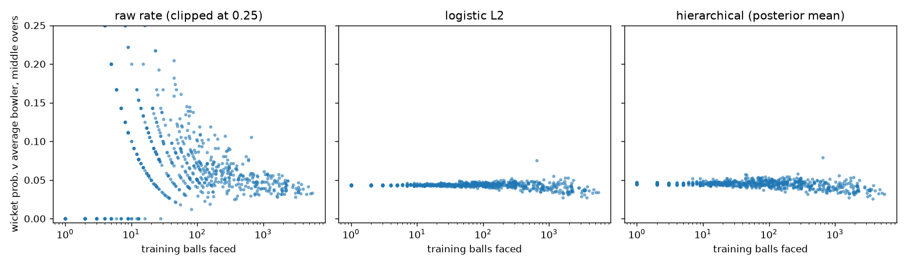
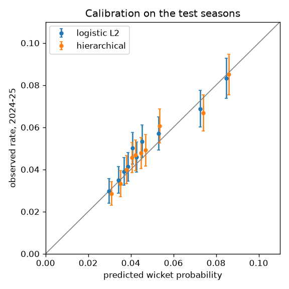

# Cricket_BA: does a hierarchical Bayesian model help with IPL wickets?

How often does a batter get out, and how often does a bowler take a wicket? Most IPL
players have faced or bowled only a few dozen balls, so their raw rates are mostly noise.
This project fits a hierarchical (partially pooled) Bayesian model in PyMC to 18 seasons
of IPL ball-by-ball data and compares it, on later seasons it has not seen, with a tuned
L2-regularised logistic regression.

**Short answer.** On point prediction the two models are close to a tie: the
hierarchical model's test log loss is lower by 0.00018, a 0.09% improvement whose 95%
interval excludes zero but not by much. What the Bayesian model adds is honest uncertainty:
every player gets an interval that is wide when the data is thin and narrow when it is
not, and those intervals cover roughly the share of outcomes they claim to. The largest
gain in prediction is for batters the model has never seen.

## Question and set-up

* **Target.** On a legal ball, does the bowler take the striker's wicket (bowled, caught,
  caught and bowled, lbw, stumped, hit wicket)? Run outs, retirements and super overs
  are left out. 267,801 legal balls, 12,586 such wickets (4.7%).
* **Split by time, never at random.** Train on 2008 to 2023 (234,995 balls), test on
  2024 and 2025 (32,806 balls). In the test seasons 12.7% of balls involve a batter, and
  11.2% a bowler, who never appears in training.
* **Baselines.** The overall training rate, the rate per phase, and an L2 logistic
  regression on one-hot batter, bowler and phase (powerplay, middle, death). Its penalty
  and feature set were chosen by expanding-window cross-validation over 2019 to 2023:
  C = 0.03, and venue was left out because it did not lower validation log loss.
* **Hierarchical model.**
  `logit p = alpha[phase] + sigma_bat * z_bat[batter] + sigma_bowl * z_bowl[bowler]
  + beta * (season - 2016) / 10`,
  with `z ~ N(0, 1)` (non-centred) and half-normal priors on the two pooling scales,
  which are learnt from the data. A player first seen in the test seasons gets a fresh
  effect drawn from `N(0, sigma)`. The linear season term was added after the first
  version (see *Season drift* below).
* **Making NUTS fast without approximating.** The linear predictor depends only on
  (batter, bowler, phase, season), so a Bernoulli likelihood on the 234,995 balls equals
  a binomial likelihood on the 54,132 cells up to a constant. Same posterior, about four
  minutes to sample. `tests/test_hierarchical.py` checks the equality numerically.

## Results

All numbers below are from `make results` (see *How to reproduce*), on the 2024-25 test
seasons.

| Model | Log loss | Brier score | Mean predicted | Observed rate |
|---|---|---|---|---|
| Overall training rate | 0.19973 | 0.04784 | 0.0465 | 0.0504 |
| Rate per phase | 0.19805 | 0.04766 | 0.0463 | 0.0504 |
| Logistic L2 (batter, bowler, phase) | 0.19726 | 0.04759 | 0.0485 | 0.0504 |
| Hierarchical (PyMC) | **0.19708** | **0.04757** | 0.0498 | 0.0504 |

Hierarchical minus logistic, with 95% intervals from 1,000 bootstrap resamples of whole
matches: log loss **-0.00018** (-0.00033 to -0.00005), Brier score -0.000015 (-0.000030
to +0.000000). The log-loss gain is real but tiny; the Brier difference cannot be told
apart from zero. In the first version, without the season term, the log-loss difference
was -0.00013 (-0.00026 to -0.00001).

The phase-rate row comes from `results/baseline_test_metrics.csv`, written by
`notebooks/02_baseline.ipynb`; the other rows from `results/test_metrics.csv`.

**Sampler.** 4 chains of 1,000 draws after 1,000 tuning steps, `target_accept` 0.95: no
divergences, R-hat at most 1.01, bulk effective sample size at least 1,027 for every
parameter.

### Where the hierarchical model helps

Test log loss split by how many training balls the player had (difference is
hierarchical minus logistic; negative favours the hierarchical model):

| Player | Training balls | Test balls | Difference | 95% interval |
|---|---|---|---|---|
| batter | unseen | 4,160 | -0.00074 | -0.00126 to -0.00033 |
| batter | 1-99 | 2,741 | -0.00002 | -0.00095 to +0.00088 |
| batter | 100-499 | 8,639 | -0.00013 | -0.00038 to +0.00015 |
| batter | 500+ | 17,266 | -0.00013 | -0.00029 to +0.00004 |
| bowler | unseen | 3,685 | +0.00010 | -0.00027 to +0.00044 |
| bowler | 1-99 | 1,646 | -0.00007 | -0.00069 to +0.00058 |
| bowler | 100-499 | 8,033 | -0.00023 | -0.00058 to +0.00006 |
| bowler | 500+ | 19,442 | -0.00022 | -0.00039 to -0.00005 |

The clearest gain is for batters new in the test seasons. The logistic model treats a
new batter as exactly average; the hierarchical model knows how far from average a new
batter tends to be, and averages over that. With the season term this gain doubled (it
was -0.00031 without it), because new batters were the most under-predicted group (see
*Season drift*). For thin but seen players the intervals are wide and include zero. I expected the gain to be largest for thin players, and the data
does not show that clearly.

### Estimates for thin and well-known players



Each point is a batter's wicket probability against an average bowler in the middle
overs (the figure is from `03_hierarchical_pymc`, before the season term; the numbers
below are from `make results` and use the 2023 season level). Raw rates for batters with
under 100 training balls have a standard deviation of 0.150 (some are 0, some are 1).
Both models pull them hard towards the average; the L2 logistic regression pulls even
harder (standard deviation 0.0013 against 0.0028), with
one penalty for every player and no measure of how unsure it is. The hierarchical model
says how unsure it is:

| Batter | Training balls | Wickets | Raw rate | Logistic | Hierarchical mean | 80% interval |
|---|---|---|---|---|---|---|
| V Kohli | 5,568 | 186 | 0.0334 | 0.0339 | 0.0330 | 0.0301 to 0.0361 |
| S Dhawan | 5,181 | 170 | 0.0328 | 0.0343 | 0.0342 | 0.0308 to 0.0375 |
| RG Sharma | 4,759 | 198 | 0.0416 | 0.0380 | 0.0392 | 0.0359 to 0.0426 |
| LPC Silva | 26 | 2 | 0.0769 | 0.0436 | 0.0472 | 0.0356 to 0.0603 |
| T Thushara | 18 | 1 | 0.0556 | 0.0428 | 0.0453 | 0.0342 to 0.0575 |
| Basil Thampi | 35 | 1 | 0.0286 | 0.0418 | 0.0428 | 0.0328 to 0.0537 |

The three thin batters were drawn at random (fixed seed) from those with 15 to 40
training balls. The median width of an 80% interval is 0.0244 for batters with under 100
training balls and 0.0120 for those with 500 or more.

### Are the intervals calibrated?

For each player with at least 60 legal balls in 2024-25, the model gives a predictive
distribution for their total wickets over those balls (with their actual opponents and
phases). How often does the real total land inside the central interval?

| Players | Model | n | 50% | 80% | 95% |
|---|---|---|---|---|---|
| batters | hierarchical | 109 | 0.59 (PIT 0.47) | 0.85 (PIT 0.84) | 0.97 (PIT 0.96) |
| batters | logistic plug-in | 109 | 0.50 (PIT 0.39) | 0.80 (PIT 0.77) | 0.94 (PIT 0.93) |
| bowlers | hierarchical | 112 | 0.55 (PIT 0.45) | 0.86 (PIT 0.79) | 0.97 (PIT 0.97) |
| bowlers | logistic plug-in | 112 | 0.53 (PIT 0.41) | 0.79 (PIT 0.72) | 0.96 (PIT 0.95) |

"Logistic plug-in" is binomial noise around the logistic point predictions, with no
parameter uncertainty. Wicket totals are whole numbers, so an interval with inclusive
ends covers a little more than its nominal level; the PIT figure is a randomised version
that corrects for this. With about 110 players per row, each figure has a standard error
of about 4 percentage points, and the simulation adds about 1 to 2 points of Monte Carlo
noise (the notebook and the pipeline differ by that much). So the 80% and 95% intervals
are about right for both models; the hierarchical ones are, if anything, slightly wide,
and this test is too small to say that one is better calibrated than the other. The 50%
PIT figures are below 0.5 in every row, which points to the under-prediction of new
batters described under *Season drift*.



### Season drift

The first version of both models predicted 4.85% for the test seasons against an observed
5.04%. The raw rate rose from 4.3% (2016) to 5.0% (2023 to 2025), and neither model had a
season term. `notebooks/04_season_drift.ipynb` tests one, choosing on 2023 as a
validation season and scoring the test seasons only at the end.


* **Most of the rise is a change of players.** With only batter, bowler and phase, the
  model's in-sample rate already rises from 4.50% (2016) to 4.78% (2022). A random-walk
  season level on top moves by 0.016 on the logit scale by 2022 (80% interval -0.016 to
  0.058), about 1.5% of the rate.
* **The choice.** A numeric season feature made the logistic baseline slightly worse in
  cross-validation (mean log loss 0.188568 against 0.188557), so it stays out. For the
  hierarchical model a linear trend and a random-walk level tied on 2023 (0.195723 and
  0.195722 against 0.195743 with no term). I kept the linear trend: one parameter, no
  divergences, and a 2023 mean prediction of 4.97% against 4.98% observed.
* **On the test seasons** the trend moves the mean prediction to 4.98% and is 0.042 per
  decade on the logit scale (94% HDI -0.009 to 0.094). Against the same model without
  it, the log-loss change is -0.000055 (95% interval -0.000114 to +0.000007), so the
  trend fixes the average but is not a clear gain ball by ball.
* **The remaining gap is new batters.** Test balls split by whether the batter and bowler
  were seen in training (`results/test_gap_by_new_player.csv`):

| Batter | Bowler | Balls | Observed | Logistic | Hierarchical |
|---|---|---|---|---|---|
| seen | seen | 25,473 | 0.0491 | 0.0487 | 0.0496 |
| seen | new | 3,173 | 0.0448 | 0.0459 | 0.0479 |
| new | seen | 3,648 | 0.0630 | 0.0500 | 0.0526 |
| new | new | 512 | 0.0566 | 0.0485 | 0.0524 |

Both models treat a new batter as an average batter, but new batters are out far more
often, probably because most of them bat in the lower order. A batting-role term is the
next step.

## Limitations

* **New batters are under-predicted.** Batters first seen in 2024-25 were out on 6.3%
  of balls against seen bowlers; the hierarchical model predicts 5.3% and the logistic
  model 5.0%. The season term fixed the overall average (4.98% predicted, 5.04% observed)
  but not this.
* **The model expects batters to differ slightly more than they do.** The posterior
  predictive check puts the observed spread of batter rates (batters with 100 or more
  balls) at the 5th percentile of the replicated spread. A likely cause is batting role:
  openers and tail-enders face very different balls and the model has no term for it.
* **Player skill is held fixed over 16 training seasons.** A batter's 2010 form counts
  the same as his 2023 form. A time-varying effect would be the natural next step.
* **Bowler effects are small and hard to pin down** (pooling scale 0.068 against 0.219
  for batters, on the log-odds scale), so the bowler side of the model adds little.
* **Venue was dropped** because cross-validation did not support it, and the package
  model has no venue term.
* **One competition.** Results are for the IPL only; whether they hold for other T20
  leagues is untested.
* **The point-prediction gain is tiny.** Anyone choosing between these two models for
  ball-by-ball probabilities alone could reasonably pick the cheaper logistic model.

## Problems caught and how they were fixed

| Problem | How it was caught | Fix | Effect |
|---|---|---|---|
| The old parser gave every row match id "unknown", innings 0 and ball 0 | Read its CSV against the raw JSON | New parser takes ids from file names and positions from list order; regression test | All 1,142 non-D/L chase targets match the parsed first-innings totals |
| One player name ("Harmeet Singh") belongs to two players; two players appear under two names | Survey of Cricsheet's player registry | Key players by registry id, not name | The two players named Harmeet Singh are modelled separately, and each renamed player once |
| 59 venue names for 38 grounds (renamed stadiums) | Listing the distinct venue names | `clean_venue` map in `features.py` | 59 names reduce to 38 |
| Posterior predictive check reported the 0th percentile | The implausible number in a trial run | Counts were grouped in `pd.factorize` order but divided in sorted order; fixed the alignment (`03`) | Check now reads the 5th percentile, a real but mild misfit |
| Test seasons under-predicted (4.85% against 5.04%) | Mean prediction against observed rate | Linear season term, chosen on 2023 validation (`04`) | Mean prediction 4.98%; gain over logistic -0.00013 to -0.00018 log loss |
| The remaining gap sat with one group | Split test balls by seen and new players (`04`) | Next: batting-role term | Located: new batters out 6.3%, predicted 5.0 to 5.3% |

## Data and licence

Ball-by-ball data for every IPL match from 2008 to 2025 (1,169 matches), from
[Cricsheet](https://cricsheet.org/). Cricsheet's JSON match data is licensed under the
[Open Data Commons Attribution License 1.0](https://opendatacommons.org/licenses/by/1-0/).
The tables and results in this repository are works produced from that data. Thanks to
Cricsheet for collecting and publishing it.

The raw files are not stored here. `make data` downloads
`https://cricsheet.org/downloads/ipl_json.zip` once (Cricsheet's robots.txt allows
`/downloads/`). The zip grows as seasons finish, so the pipeline keeps the 2008 to 2025
seasons explicitly. Four unchanged match files are kept in `tests/fixtures/` for the
tests, under the same licence.

**Data checks.** The JSON has no scorecard totals, but every chase carries a target. In
all 1,142 chases not affected by Duckworth-Lewis, the parsed first-innings total equals
the target minus one. Players are keyed by Cricsheet registry id, not by name: one name
("Harmeet Singh") belongs to two different players, and two players appear under two
names. 59 raw venue names reduce to 38 grounds.

An earlier parser (October 2025, not in this repository) produced a ball-level CSV in
which every row had match id "unknown", innings 0 and ball 0, because it read keys that
Cricsheet does not provide. `src/cricket_ba/parse.py` replaces it, and
`tests/test_parse.py` includes a regression test.

## How to reproduce

Needs [uv](https://docs.astral.sh/uv/) and a C compiler (PyTensor compiles the model).

```
uv sync --locked     # .venv with the exact versions in uv.lock
make data            # download the Cricsheet JSON
make results         # parse, fit both models, write results/ (about 5 minutes on 8 cores)
make test lint       # what CI runs: ruff and pytest, no MCMC
```

The notebooks were run in order: `01_eda`, `02_baseline`, `03_hierarchical_pymc`,
`04_season_drift`. `03` is the first version, without the season term.
`make results` reruns the analysis from the package code in `src/cricket_ba/` and is the
source of the numbers above. It reproduces the notebooks' sampler diagnostics and
baseline numbers exactly; the hierarchical numbers agree to the precision shown here,
and differ further down because two random steps are drawn in a different order. The
seed (20261112), sampler settings and package versions are in
`results/hierarchical_run.json`.

```
src/cricket_ba/   parse.py (Cricsheet JSON to tables), features.py, baseline.py,
                  hierarchical.py (PyMC model), evaluate.py, pipeline.py
notebooks/        01_eda, 02_baseline, 03_hierarchical_pymc, 04_season_drift
tests/            pytest, with four Cricsheet fixture matches
results/          tables written by `make results` and the notebooks
figures/          figures written by the notebooks
scripts/          download_data.py
```

## How I built this with an AI coding agent

I built this project with Claude Code (Anthropic's coding agent) working in my
terminal, from a written brief that set the question, the build plan and the rules:
split by time, report whatever the data shows, no fabricated numbers, real commit
timestamps.

**What the agent did.** It read the existing folder and confirmed the old parser's bug
against the data, surveyed all 1,169 match files for edge cases (super overs, miscounted
overs, penalty runs, no-results), wrote the new parser and its tests, drafted and ran
the three notebooks, ported the code into `src/cricket_ba/`, and wrote the CI workflow
and a first draft of this README. In a second session, a day later, it ran the
season-drift analysis (`04_season_drift`), ported the chosen season term into the package
and updated the results here.

**What I decided.** The question and the framing (that the case for the Bayesian model is
uncertainty and thin-data players, not accuracy), the time split, the rule that every
number must come from code run in this repository, and the move from conda to uv when
the conda-forge solve was still running after many minutes.

**Where the agent was wrong and had to be caught.**

* The posterior predictive check first reported that the observed spread of batter rates
  sat at the 0th percentile of the replicated spread. The cause was an indexing bug: the
  replicated wicket counts were grouped in order of first appearance (`pd.factorize`)
  but divided by ball counts in sorted order. The implausible number in a short trial run
  was the clue; the fix is in `03_hierarchical_pymc`.
* A parser test assumed a missing winner is stored as `None`. Under pandas 3 it is `NaN`,
  and the test failed after the environment changed.
* A model test looked for the prior draws in the wrong part of PyMC's `InferenceData`,
  and a dataclass used a mutable default. Both failed when the tests first ran and were
  fixed before committing.
